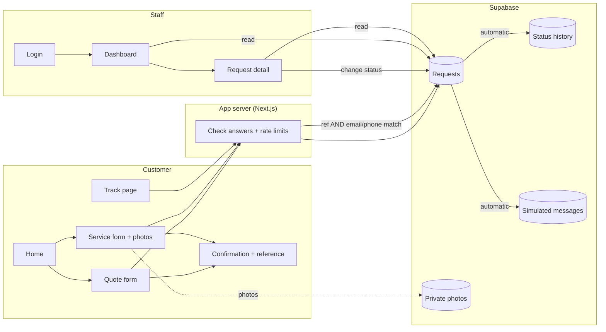

# How the Rain Bird Service Hub works

A plain-language explanation you can present in about three minutes.

## The problem

Rain Bird Nigeria installs pumps, firefighting systems and water treatment for farms, factories, hotels, building sites and government offices. Today, customers ask for quotes and report faults by phone or email. That causes four problems:

1. **Urgent faults get buried.** A fire pump that will not start sits in the same inbox as a general question.
2. **Customers keep calling for updates**, because they cannot see what is happening.
3. **Engineers ask the same questions on every call**, because details arrive in different shapes.
4. **Faults are hard to diagnose without photos.**

## The idea

One shared system with two sides:

- **A customer side** with no account needed. Fill in a short form, get a reference number like `SV-1042`, and check progress any time.
- **A staff side** where every request lands in one list, critical faults first, and staff move each request through four stages: **Received, Assigned, Scheduled, Done**.

When staff move a request forward, the customer's tracker updates straight away, and the system prepares the email and WhatsApp message it would send.

## The diagram

```
            CUSTOMER (phone or laptop)                                STAFF (logged in)
 ┌───────────────────────────────────────────┐            ┌────────────────────────────────────┐
 │  Home ──► Quote form (4 steps)            │            │  Login                             │
 │      └──► Service form (+ up to 3 photos) │            │    │                               │
 │                │                          │            │    ▼                               │
 │                ▼                          │            │  Dashboard                         │
 │      Confirmation: "Your ref is SV-1042"  │            │   • critical first, then oldest    │
 │                                           │            │   • filters, search, counters      │
 │      Track page: ref + email/phone        │            │    │                               │
 │        Received ● Assigned ● Scheduled ○  │            │    ▼                               │
 └───────┬──────────────────────▲────────────┘            │  Request detail                    │
         │ send request         │ status + public notes   │   • photos, history, notes         │
         ▼                      │ (only if BOTH match)    │   • change status, pick engineer   │
 ┌──────────────────────────────┴────────────┐            └──────────┬──────────▲──────────────┘
 │      THE APP'S SERVER (Next.js on Vercel) │◄───────────────────────┘          │
 │  • checks every answer again (Zod)        │      updates, as the logged-in    │
 │  • blocks spam (rate limits, bot trap)    │      staff member                 │
 └──────────────────────┬────────────────────┘                                   │
                        ▼                                                        │
 ┌─────────────────────────────────────────────────────────────────────────────┐ │
 │  SUPABASE                                                                    │ │
 │   Database tables: requests, status_history, request_notes, engineers,       │─┘
 │                    request_photos, notifications_log                         │
 │   Security rules:  the public can ADD a request but can never READ one.      │
 │                    Only staff can read and change requests.                  │
 │   Automatic steps: every status change writes a history row and two          │
 │                    "would-be" messages (email + WhatsApp). Nothing is sent.  │
 │   Photo storage:   private. Photos go straight from the phone to here.       │
 └──────────────────────────────────────────────────────────────────────────────┘
```

The same picture as a flowchart (GitHub shows this as a diagram):



## Walking through one request

1. **Mrs Hauwa's fire pump will not start.** On her phone she opens the site, taps **Request service**, picks **Critical**, describes the fault and adds a photo of the control panel. The photo is shrunk on her phone first to save data.
2. **She gets `SV-1042` straight away.** The request is already in the staff list, at the very top, because it is critical.
3. **A staff member opens it**, sees the photo, and assigns Ibrahim, the firefighting engineer. The status moves to **Assigned** automatically. They add a public note: "Ibrahim is on his way."
4. **The database records it**: a history row ("Received to Assigned, by Demo Staff, 10:42") and two prepared messages, one email and one WhatsApp, which staff can read on the request page.
5. **Mrs Hauwa opens Track**, types `SV-1042` and her phone number, and sees the pipe filled up to **Assigned**, Ibrahim's name and the note. She did not have to phone anyone.

## Why it is safe

- **Tracking needs two keys.** The reference number alone shows nothing. You also need the email or phone number used on the form. If either is wrong, the answer is the same "we could not find it" message, so nobody can tell whether a reference exists.
- **The public can add but not read.** The database itself enforces this, so even someone who bypasses the website cannot read other customers' requests.
- **Customers cannot cheat the queue.** The database ignores any attempt by the public to set a status or engineer.
- **Spam is limited.** Each connection can send at most 5 requests and try 20 tracking lookups every 10 minutes. A hidden "bot trap" field catches simple spam robots.
- **Photos are private.** Only staff can view them, through links that expire after 10 minutes.
- **Internal notes stay internal.** Staff can write notes the customer never sees.

## What makes it useful

| Before | After |
|---|---|
| Faults arrive by phone and email, in no order | One list, critical faults first, then oldest |
| Customers call to ask "any update?" | Customers check the tracker themselves |
| Engineers ask the same questions on each call | The form collects site type, water source, equipment and urgency every time |
| Hard to diagnose without seeing the fault | Up to 3 photos with every service request |
| No record of who did what, when | Every status change is logged with a time and a name |

## Key words, explained

- **Reference number:** the short code (QT- for quotes, SV- for service) that identifies a request.
- **Status:** where the request is: Received, Assigned, Scheduled or Done.
- **Database:** where all the information is stored, like a set of very strict spreadsheets.
- **Row Level Security:** rules inside the database that decide who can see or change each row.
- **Rate limit:** a cap on how many times one connection can do something in a set time.
- **Simulated notification:** the message the system *would* send. In this prototype it is written down but not sent.
